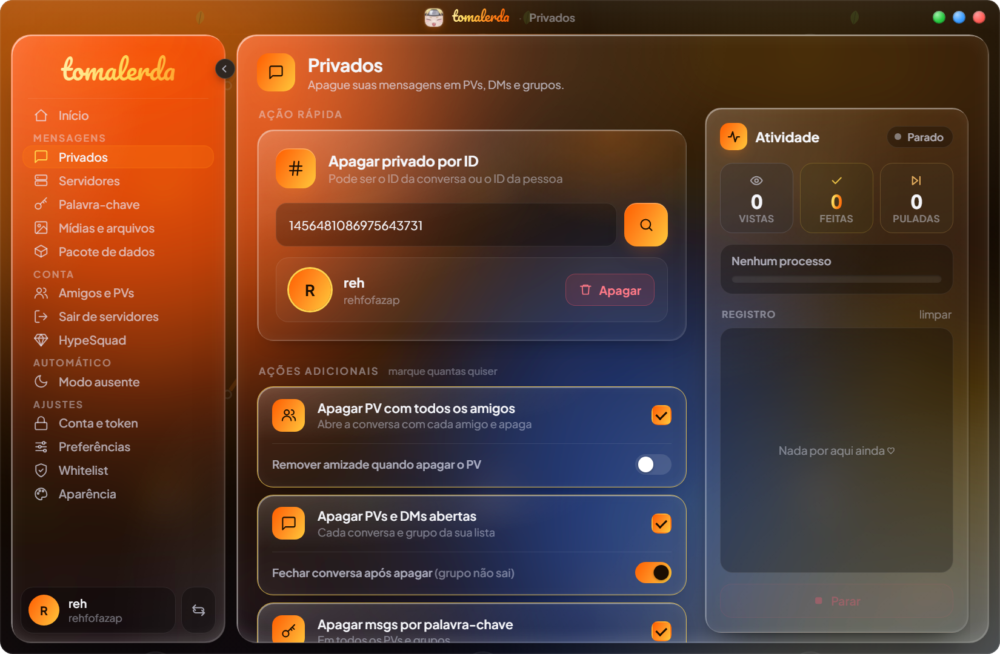
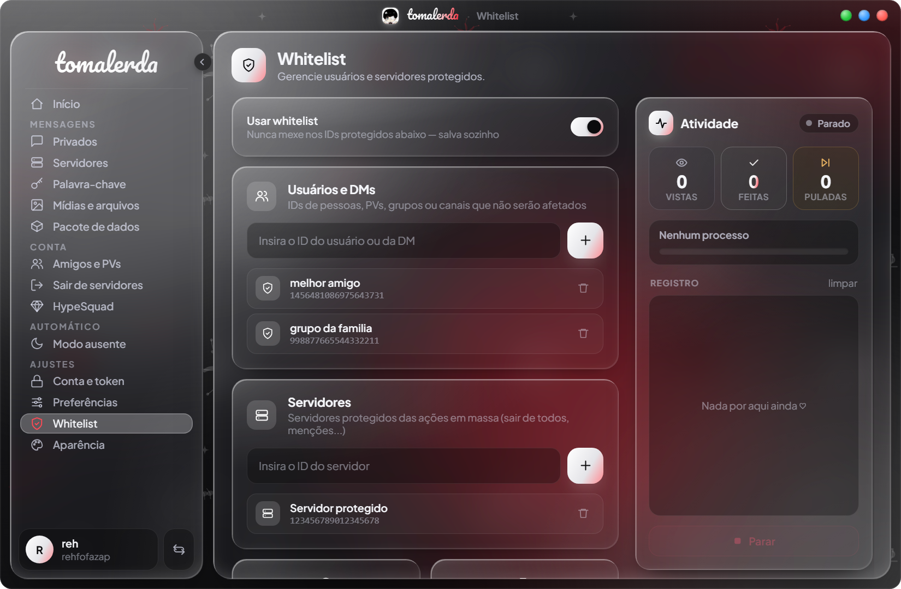
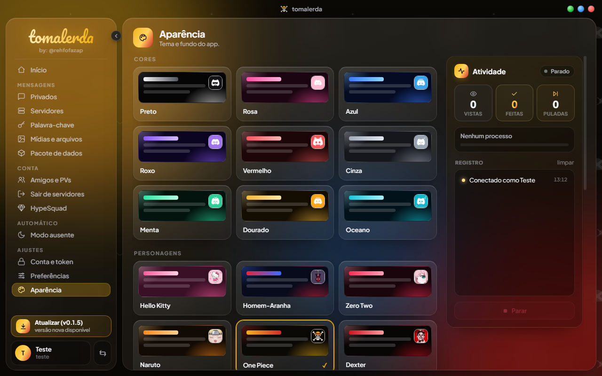

<div align="center">


# tomalerda

apaga suas mensagens do discord sem precisar ficar clicando uma por uma 🗑️

[](https://github.com/rehfofazap/tomalerda/releases/latest)
[](https://github.com/rehfofazap/tomalerda/releases)
[](LICENSE)


</div>

> [!WARNING]
> o tomalerda usa o token da sua conta (selfbot), e isso é **contra os termos do discord e pode dar ban**. usa por sua conta e risco e deixa um delay de pelo menos 1–2 s. o que for apagado **não volta**.

## o que dá pra fazer

- apagar suas mensagens de um PV, DM ou grupo pelo ID (aparece a foto e o nome de quem é antes de apagar)
- várias coisas de uma vez: PV com todos os amigos, todas as DMs abertas, palavra-chave em todos os PVs e mídias, num clique só
- depois de apagar, se quiser: desfazer a amizade ou fechar a conversa
- apagar num canal ou no servidor inteiro (com as menções junto)
- apagar só as que tem uma palavra (dá pra pôr várias)
- apagar só mídias e arquivos (fotos, vídeos, áudios...)
- usar o pacote de dados do discord (`package.zip`) pra achar mensagem que a busca não mostra
- desfazer todas as amizades, fechar todos os PVs, sair de todos os servidores
- trocar a casa da hypesquad
- modo ausente: sai de grupo quando te adicionam, fecha PV, fica afk em call e responde sozinho

antes de começar ele conta quantas mensagens suas tem, então mostra **quantas já foram de quantas**, a % e quanto tempo falta.

também tem whitelist (pessoas, conversas e servidores que nunca são mexidos), filtro por data, delay configurável, várias contas salvas (trocar ou sair pelo menu do seu perfil) e atualiza sozinho.

<div align="center">

<br/><br/>

</div>

## temas

tem 18 temas, cada um com cor, fundo e ícone próprio (o ícone da barra de tarefas muda junto), 6 estilos de painel (sólido, translúcido, vidro, liquid glass, acrílico e neon) e dá pra regular a intensidade, o desfoque e pôr uma imagem de fundo:

preto, rosa, azul, roxo, vermelho, cinza, menta, dourado, oceano, hello kitty, homem-aranha, zero two, naruto, one piece, dexter, rick and morty, hora de aventura e tokyo ghoul

<div align="center">

<br/><br/>

</div>

## como instalar

1. baixa o `.exe` na aba [releases](https://github.com/rehfofazap/tomalerda/releases/latest) ou na [tomalerda.com](https://tomalerda.com)
2. abre e instala. se o windows reclamar ("o windows protegeu o computador"), clica em **mais informações** e depois **executar assim mesmo** (o instalador ainda não tem assinatura de editor)
3. cola seu token e pronto

o app procura versão nova sozinho e instala quando você não está apagando nada.

**conferir o download:** cada release tem o sha256 do instalador nas notas. no PowerShell: `Get-FileHash .\tomalerda_x.x.x_x64-setup.exe` e compara.

pra pegar ID de alguma coisa: configurações do discord > avançado > liga o **modo desenvolvedor**, aí é só clicar com o botão direito em qualquer servidor/canal/pessoa e **copiar ID**.

## compilar

precisa de [rust](https://rustup.rs), node 18+ e o build tools do visual studio (c++).

```bash
npm install
npm run dev     # roda em modo dev
npm run build   # gera o instalador em src-tauri/target/release/bundle
```

o build tenta assinar os arquivos de atualização. se for compilar por conta própria, desliga o `createUpdaterArtifacts` no `src-tauri/tauri.conf.json` ou gera uma chave sua com `npx tauri signer generate`.

feito com tauri v2, a interface é html/css/js puro e a parte do discord fica em `src-tauri/src/discord.rs`. quer ajudar? dá uma olhada no [CONTRIBUTING](CONTRIBUTING.md).

## segurança e privacidade

- o token fica salvo no cofre do windows e só vai pro próprio discord
- o app não coleta nada de quem usa
- as atualizações são assinadas e o app confere antes de instalar
- achou uma falha? manda pelo [relato privado](https://github.com/rehfofazap/tomalerda/security/advisories/new), não em issue pública ([SECURITY](SECURITY.md))

**nunca passa seu token pra ninguém.** com ele a pessoa tem acesso total à sua conta.

não tenho ligação nenhuma com o discord. os personagens dos temas são dos seus donos, é só homenagem.

---

<div align="center">by <b>@rehfofazap</b> 💗</div>
