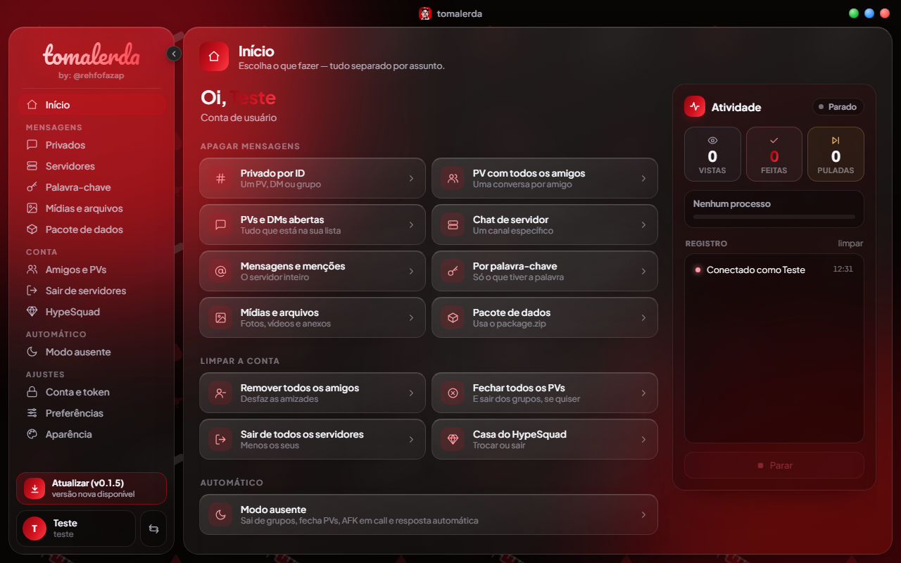
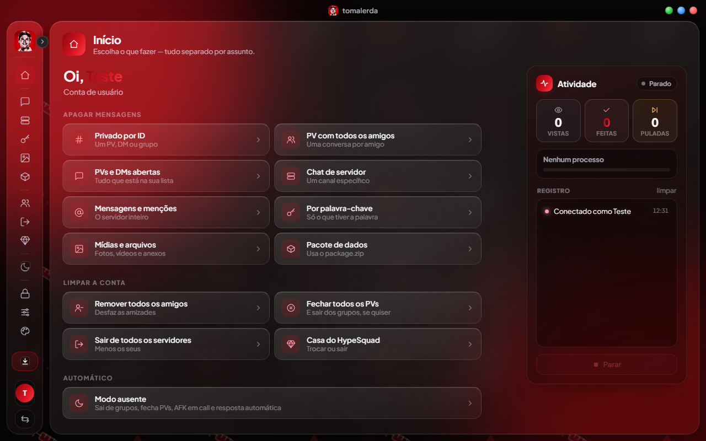

<div align="center">


# tomalerda

**Apague suas mensagens do Discord com poucos cliques.**
Privados, servidores, mídias, amigos e muito mais — num app leve, bonito e com temas.

[](https://github.com/rehfofazap/tomalerda/releases/latest)
[](https://github.com/rehfofazap/tomalerda/releases)
[](https://v2.tauri.app)
[](LICENSE)



</div>

---

## ✨ O que ele faz

| | Função | Como funciona |
|---|---|---|
| 💬 | **Privado por ID** | Apaga suas mensagens num PV, DM ou grupo |
| 👥 | **PVs com todos os amigos** | Abre a conversa com cada amigo e limpa |
| 📨 | **PVs e DMs abertas** | Limpa tudo que está na sua lista de conversas |
| 🖥️ | **Servidores** | Um canal específico, ou o servidor inteiro com as menções |
| 🔑 | **Palavra-chave** | Só as mensagens que tiverem uma palavra |
| 🖼️ | **Mídias e arquivos** | Fotos, vídeos, áudios e anexos que você mandou |
| 📦 | **Pacote de dados** | Usa o `package.zip` do Discord pra achar mensagens que a busca não mostra |
| 🧹 | **Limpar a conta** | Desfazer amizades, fechar PVs, sair de servidores, trocar a casa da HypeSquad |
| 🌙 | **Modo ausente** | Sai de grupos, fecha PVs, fica AFK em call e responde sozinho enquanto você está fora |

**E mais:**
- ⏱️ **Tempo estimado** — mostra quanto falta e a velocidade real ("falta ~12 min · 48 por min")
- 🛡️ **Whitelist** — IDs de pessoas, canais e servidores que nunca são tocados
- 📅 **Período** — apague só mensagens entre duas datas
- 🔁 **Trocar de conta** sem fechar o app
- 🔐 **Token guardado no Cofre do Windows** — nunca sai do seu PC, só vai pro Discord
- 🔄 **Atualização automática** — só instala pacotes assinados pela chave do projeto
- ✅ **Confirmação em dois cliques** em tudo — nada é apagado sem querer

## 🎨 Temas

16 temas, cada um com cores, desenho de fundo e ícone próprios (até o da barra de tarefas muda):
**cores** — Preto, Rosa, Azul, Roxo, Vermelho, Cinza, Menta, Dourado, Oceano ·
**personagens** — Hello Kitty, Homem-Aranha, Zero Two, Naruto, One Piece, Dexter, Rick and Morty, Hora de Aventura.
Mais 6 estilos de painel (vidro, acrílico, neon…) e imagem de fundo personalizada.

<div align="center">

<br/><br/>

</div>

## 📥 Instalar

1. Baixe o `tomalerda_x.y.z_x64-setup.exe` na página de **[Releases](https://github.com/rehfofazap/tomalerda/releases/latest)**.
2. Abra e instale. Se aparecer **"O Windows protegeu o computador"**, clique em **Mais informações → Executar assim mesmo** (o instalador não tem certificado pago).
3. Cole seu token e pronto.

> **Como pegar IDs:** Discord → Configurações → Avançado → ative o **Modo desenvolvedor**. Depois clique com o botão direito num servidor, canal ou usuário → *Copiar ID*.

## 🛠️ Compilar você mesmo

Requisitos: [Rust](https://rustup.rs) (stable), Node.js 18+ e, no Windows, o WebView2 (já vem no 10/11) e o *Desktop development with C++* do Visual Studio Build Tools.

```bash
npm install
npm run dev      # abre o app em modo desenvolvimento
npm run build    # gera o instalador em src-tauri/target/release/bundle
```

> O build gera os pacotes de atualização assinados (`createUpdaterArtifacts`). Pra compilar sem a chave do projeto, desligue essa opção em `src-tauri/tauri.conf.json` ou gere a sua com `npx tauri signer generate`.

```
src/                      interface (HTML/CSS/JS puro, sem framework)
src/temas/                ícones de cada tema
src-tauri/src/lib.rs      comandos do app: conta, cofre, atualização, ícone do tema
src-tauri/src/discord.rs  cliente da API do Discord + lógica de exclusão
```

Rate limit (429) e indexação da busca (202) do Discord são tratados automaticamente.

## ⚠️ Aviso

Tudo que o app apaga é **de verdade** e não volta.

Automatizar uma conta de **usuário** (self-bot) vai contra os Termos de Serviço do Discord e pode levar ao banimento da conta. Use delays generosos (1–2 s) e por sua conta e risco. Com token de **bot** não há esse problema, mas o bot só alcança servidores em que está e precisa da permissão *Gerenciar mensagens*.

**Nunca compartilhe seu token:** com ele, qualquer pessoa tem acesso total à sua conta.

Este projeto não tem ligação com o Discord Inc. Os ícones de personagens são homenagens de fã e pertencem aos seus donos.

---

<div align="center">feito com 💗 por <b>@rehfofazap</b></div>
